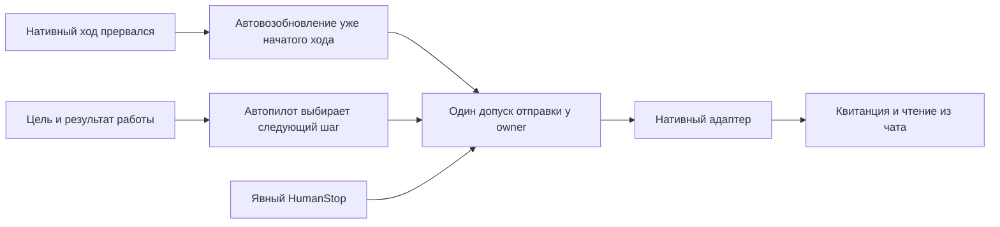

# Системы Agent Herder

Карта текущей архитектуры и целевые спецификации для её исправления. Системы выделены по самостоятельному результату и владельцу состояния. Rust, TypeScript-совместимость и конкретный транспорт описаны в документе своей системы. «Сейчас» в статьях опирается на код этого рабочего дерева, `fad29a86` с PR #123. Установленный процесс и реальный потребительский результат проверяются на этапе приёмки.

## Карта систем

| Система | За что отвечает |
| --- | --- |
| [Ядро, API и совместимость](runtime-and-api.md) | Поддерживаемые команды, идентичность вызова и один прикладной путь для MCP, CLI и Web. |
| [Нативные харнессы и протокол адаптеров](native-adapters.md) | Возможности каждого экземпляра, родной протокол, переход между Rust и совместимыми портами. |
| [Сессии, история, поиск и экспорт](sessions-and-history.md) | Каталог, адреса сессий, последние 100 сообщений, старшие страницы и provenance. |
| [Контекст и перенос сессий](context-and-portability.md) | Короткие отчёты с полным оригиналом, явная конвертация истории и признаки полноты. |
| [Доставка, очередь и квитанции](delivery.md) | Один нативный эффект, очередь, сверка результата и повтор запроса с тем же ключом. |
| [HumanStop и нативные разрешения](stop-and-permissions.md) | Подтверждённое действие человека, область hold и адресный ответ на запрос разрешения. |
| [Автовозобновление](recovery.md) | Продолжение уже начатого хода после прерывания, первичная и резервная попытки. |
| [Модели, квоты и маршруты](models-and-routing.md) | Исходная модель, квота фактического аккаунта, проектное разрешение и выбор резерва. |
| [Автопилот](autopilot.md) | Цель, следующий шаг, оценка завершённости и уведомление родителя. |
| [Расписание и ожидания](scheduler.md) | Запланированный запуск, cadence, resume-after, зависимость по событию и отмена правила. |
| [Вопросы человеку](human-requests.md) | Внешний запрос, точный ответ, разрешение отправки и возврат в исходную сессию. |
| [Расширение Chrome](browser-extension.md) | Установка в обычный профиль и прямое соединение с Herder. |
| [Адаптеры веб-чатов](browser-chat-adapters.md) | Нативное чтение, отправка и recovery ChatGPT и Z.ai. |
| [Браузерные аккаунты](browser-accounts.md) | Независимые экземпляры, профиль аккаунта и добавление второго без миграции первого. |
| [Координация](coordination.md) | Доски, состав участников, выбор новой информации и адресные поручения. |
| [Интеграции, плагины и хуки](harness-integrations.md) | Приём нативных событий, точный контекст и работа подключений харнессов. |
| [Межхостовая маршрутизация](fleet-routing.md) | Discovery, путь до ноды-владельца, интегратор и направление квитанций. |
| [Проекты и worktree](projects-and-workspaces.md) | Область проекта, видимость, рабочий каталог и запуск в выбранном checkout. |
| [Ресурсы и аренды](resources-and-leases.md) | Доступ к общим ресурсам, claims, release occupancy и передача владения. |
| [Наблюдение за заданиями и процессами](process-supervision.md) | Локальные и удалённые задания, фактическая идентичность процесса и результат. |
| [Настройки](settings.md) | Точный scope, владелец настройки, ревизия и подтверждение применения. |
| [Рабочий кабинет](operator-ui.md) | Точное отображение фактов, управление чатом и очередь в Web. |
| [События, наблюдаемость и инциденты](events-and-health.md) | Журнал, статистика, прогресс и внешний контур Notice Place. |
| [Выпуск и переключение runtime](releases.md) | Сборка, селектор, автозапуск, возврат к предыдущей версии и квитанция установки. |

## Функциональная архитектура

> 🧠 **From Hindsight memory (Agent Herder parallel Rust adapter completion)** — Доменные решения, расписание и журнал попыток принадлежат общему приложению Rust. Адаптеры предоставляют наблюдения и выполняют операции своего харнесса.

Чистые функции принимают нормализованные факты, события, время и сохранённое состояние. На выходе — решение, причина и требуемый эффект. Прикладной слой последовательно выполняет эффекты через существующие порты БД, часов, очереди и адаптеров. Запись намерения, вызов и readback принадлежат одному owner. Для порта тестируются перевод родных фактов и нативная квитанция, для чистой функции — переходы, для цепочки — один наблюдаемый пользовательский результат. [Нормативная спецификация](../AGENT-HERDER-SPEC.md)

Каждую проверку оцениваем по конкретному вреду, который она предотвращает, и по работе, которую она может задержать. Точный адрес защищает чужой чат. Сравнение последнего ввода защищает уже продолженную работу. HumanStop защищает намерение владельца. Сохранённый ключ защищает от второй отправки. Если проверка дублирует существующий факт или использует косвенный признак вместо прямого, её функцию переносим к владельцу факта и меряем число пропущенных допусков. Состояние цели остаётся в автопилоте.

## Порядок архитектурных исправлений

1. **P0 · Автовозобновление Codex.** Красный fake `429` для заранее заблокированной цели → убрать проверку цели из допуска текущего хода и предков → повторить сценарий без цели и с ней → проверить HumanStop, новый ввод и число нативных ходов. В CI доказательство даёт fake model. После выпуска обычный потребитель сверяет первый естественный сбой, маршрут и квитанцию. [Файлы и приёмка](recovery.md)
2. **P0 · Доставка через расширение.** На штатном Chrome-профиле server100 подтвердить прямое соединение и точный чат; в стенде провести одну отправку через собственное расширение. Отдельно включать recovery для сайта, который даёт факт актуального прерывания, связанный с нативным вводом. Видимость, чтение и обычная отправка проверяются независимо от recovery. [Расширение](browser-extension.md) · [Отправка и recovery](browser-chat-adapters.md)
3. **Следующий вертикальный срез · Второй Z.ai аккаунт.** Добавить профиль B, проверить два экземпляра и сохранность A. Отсутствие второго аккаунта не задерживает восстановление Codex или отправку из уже привязанного браузерного аккаунта. [Профили и селектор](browser-accounts.md)

Для одной правки достаточно одной красной регрессии, узкого изменения и повторного прогона, которые показывают причинную разницу. Два P0 можно выполнить параллельно. Выпуск использует одну штатную команду и квитанцию запущенной версии. Остальные спецификации задают границы изменений и отдельные задачи по подтверждённой необходимости. [Команда выпуска](releases.md)
